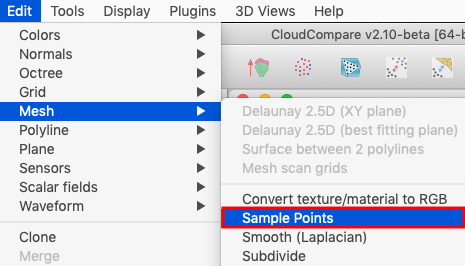
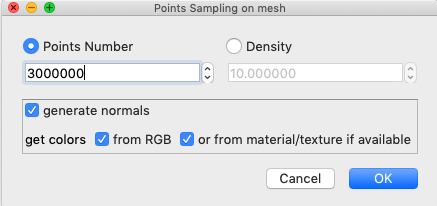
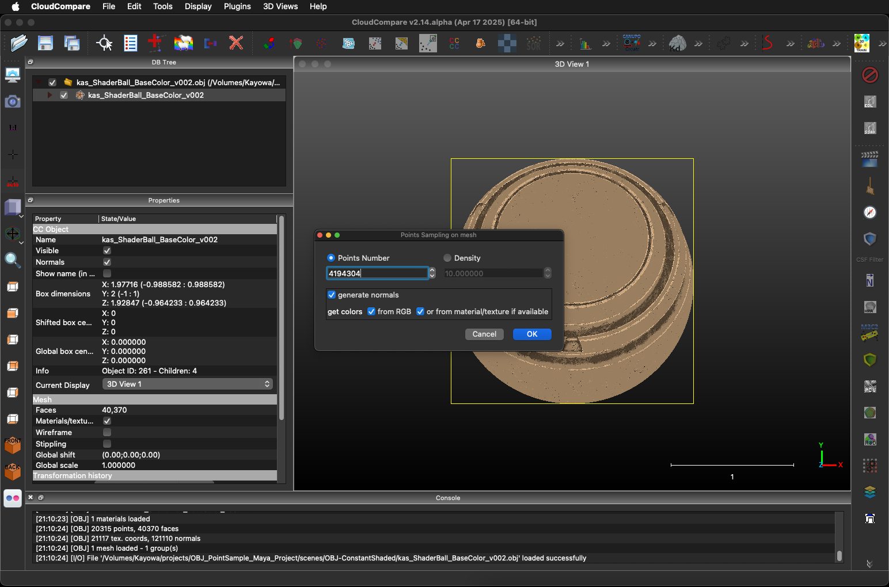
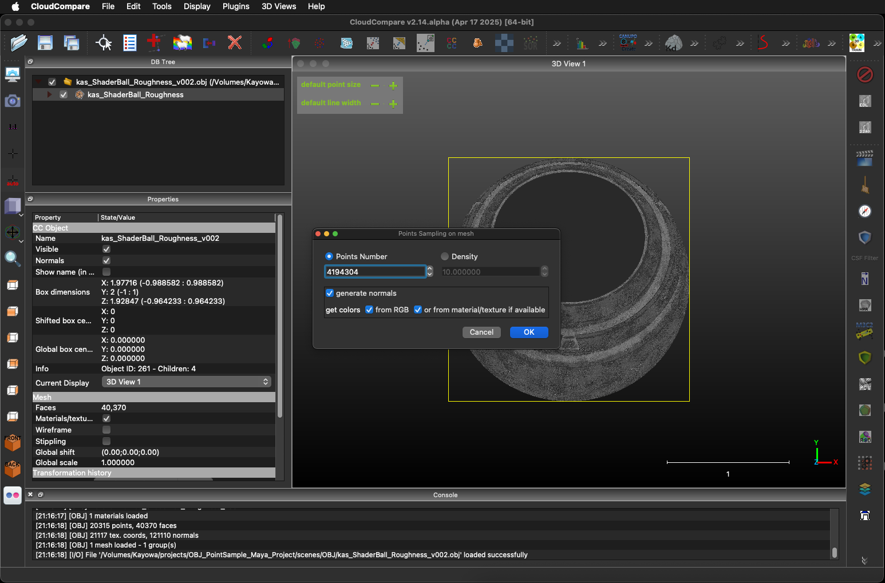
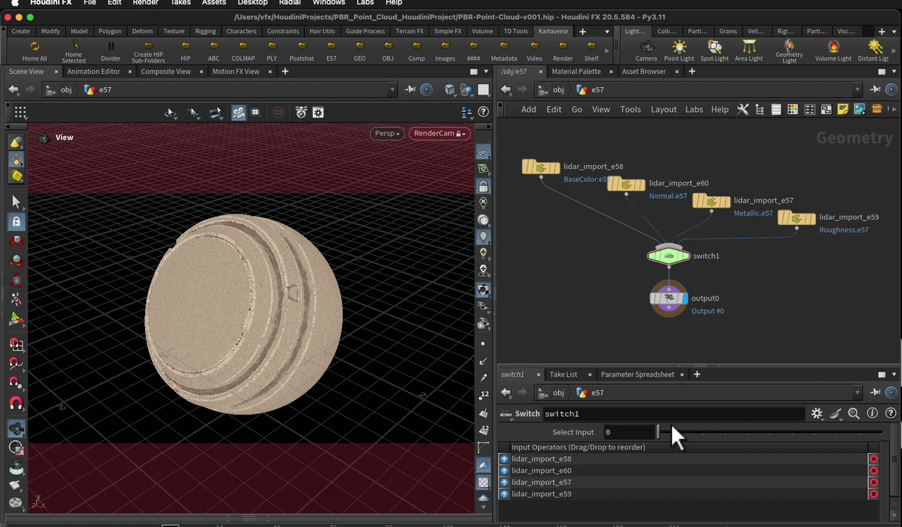

# Point Cloud Relighting

> Media Captured: June 5, 2025

Example Media By: Andrew Hazelden `<andrew@andrewhazelden.com>`  
Media License: Creative Commons CC0  

## Overview

This dataset shows how a PBR textured mesh can be baked into a point cloud that stores the individual PBR texture passes as compressed e57 point cloud, and RGB color based PLY files.

The CloudCompare, Autodesk Maya, and Side Houdini software packages were used to prepare the assets in this example project.

## Datasets

The source meshes are provided in Wavefront OBJ (.obj), and Maya ASCII (.ma) format. The PBR texture maps are stored as PNG images at 2048x2048 px resolution.

Maya ASCII Scene Files

- kas_ShaderBall_BaseColor_v002.ma
- kas_ShaderBall_Metallic_v002.ma
- kas_ShaderBall_Normal_v002.ma
- kas_ShaderBall_Roughness_v002.ma
- kas_ShaderBall_v001.ma
- kas_ShaderBall_v002.ma

Wavefront OBJs (with corresponding MTL files):

- kas_ShaderBall_Roughness_v002.obj
- kas_ShaderBall_Normal_v002.obj
- kas_ShaderBall_Metallic_v002.obj
- kas_ShaderBall_BaseColor_v002.obj

PBR Texture Maps:

- PreviewSphere_Sphere_BaseColor.png
- PreviewSphere_Sphere_Height.png
- PreviewSphere_Sphere_Metallic.png
- PreviewSphere_Sphere_Normal.png
- PreviewSphere_Sphere_Roughness.png

e57 Point Clouds:

- BaseColor.e57
- Metallic.e57
- Normal.e57
- Roughness.e57

RGB Color PLY Point Clouds:

- kas_ShaderBall_BaseColor.ply
- kas_ShaderBall_Metallic.ply
- kas_ShaderBall_Normal.ply
- kas_ShaderBall_Roughness.ply

## Cloud Compare Point Sampling

CloudCompare has a Points Sampling on mesh feature that allows a polygon model to be converted into a point cloud. You can access this feature from the Edit > Mesh > Sample Points menu.

The Points Sampling on mesh tool supports the conversion of RGB texture maps assigned to the polygon model into RGB color values stored on each of the point samples in the point cloud output.

The results of applying a per-PBR texture pass conversion to e57 look like this:

## Houdini e57 Point Cloud Example Scene

The resulting e57 point clouds are loaded into a Houdini scene file named "PBR-Point-Cloud-v001.hip". 

The LIDAR import node in houdini allows the e57 data to be loaded so the point cloud samples are able to be reworked. A Switch node in houdini makes it easy to toggle between the PBR passes to quickly compare the RGB colored point samples.

